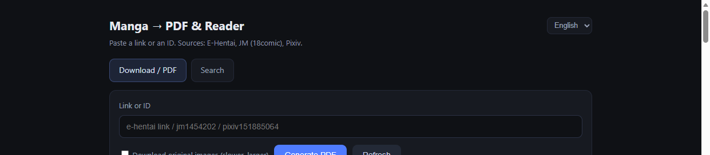

# manga-to-pdf

> ## ⚠️ Please read before using
>
> **Personal use only · non-commercial.** A hobby tool for running **your own** little server.
> It is not a service; no public instance is operated or endorsed here.
>
> **Please support the official releases.** Buy the books, subscribe to the sites you use, and
> respect their terms. This tool does **not** bypass paywalls, DRM, subscriptions or region
> locks — if a work is paid or restricted, use the official platform.
>
> **It is incomplete.** Single worker, best-effort retries, four UI languages, manual testing.
> Expect breakage when sites change.
>
> **Some features only exist upstream.** Reading-progress sync, comments, release notifications,
> account-bound favourites, offline libraries — none of that is here. Use the official app for
> those.
>
> **Self-host it, don't crowd someone else's box.** The point of publishing this is so you can
> run your own copy. Please don't treat an existing deployment as a public service.
>
> See [NOTICE.md](NOTICE.md) for the full text.

Self-hosted web app that turns a gallery link (or an ID) into a **PDF**, and lets you **read it
in the browser**. Supports **E-Hentai / ExHentai**, **JM (18comic)** and **Pixiv**.

```
paste link/ID → fetch images → build PDF → read online or download
```



> **Personal use only.** The software is a thin web UI over public downloaders. The content it
> fetches is copyrighted and belongs to its authors; respect each site's terms of service and the
> law in your jurisdiction. Do not redistribute what you download.

## Features

| | |
|---|---|
| **Sources** | E-Hentai / ExHentai, JM (18comic), Pixiv (artwork, user page) |
| **Search** | by title or author, paginated, across every source |
| **Reader** | in-browser paged reading, works while the download is still running |
| **Output** | PDF built with `img2pdf` (lossless for JPEG/PNG) |
| **Storage** | automatic cleanup by age → job count → total size (oldest first) |
| **Alerts** | `/api/status` + optional e-mail alerts when disk or cache crosses a threshold |
| **i18n** | UI in English (default), 中文, 日本語 — switchable at runtime |
| **Resilience** | E-Hentai IP bans are detected and the proxy exit node is rotated automatically |

## How it works

```
browser ──HTTP──> nginx ──> FastAPI (127.0.0.1:8099)
                                │
             ┌──────────────────┼───────────────────┐
       gallery-dl            jmcomic            Pixiv AJAX
       (E-Hentai)              (JM)              (no login)
             │                  │                    │
          HTTP proxy          direct              HTTP proxy
             └──────────────────┴────── img2pdf ────┘
```

- **E-Hentai** needs a proxy when the server is outside the site's reachable regions; an `EH`
  fallback group in the proxy config is rotated when the exit IP gets rate-limited.
- **JM** is fetched with [`jmcomic`](https://github.com/hect0x7/JMComic-Crawler-Python).
- **Pixiv** uses the public `/ajax/*` endpoints, so **no OAuth or login is required** for public
  works. The 1200px variant is used by default; tick *"original images"* for the full resolution.
  R-18 works need a `PHPSESSID` cookie (`config/pixiv_cookies.txt`).

## Requirements

- Linux (tested on Ubuntu 24.04), Python 3.10+
- A reverse proxy (nginx) if you want it on port 80/443
- Optional: a SOCKS/HTTP proxy for sources that are blocked from your server

## Quick start

```bash
sudo mkdir -p /opt/manga && sudo chown "$USER" /opt/manga
cd /opt/manga

python3 -m venv venv
./venv/bin/pip install -U pip
./venv/bin/pip install -r requirements.txt      # add -i https://mirrors.aliyun.com/pypi/simple/ in CN

git clone https://github.com/<you>/manga-to-pdf.git src
cp -r src/app src/config src/scripts .
cp src/deploy/manga.service /tmp/ && sudo mv /tmp/manga.service /etc/systemd/system/

sudo systemctl daemon-reload
sudo systemctl enable --now manga
curl -s -o /dev/null -w '%{http_code}\n' http://127.0.0.1:8099/     # -> 200
```

Then expose it. Minimal nginx (full sample in `deploy/nginx-manga.conf`):

```nginx
location /manga/ {
    proxy_pass http://127.0.0.1:8099/;
    proxy_http_version 1.1;
    proxy_set_header Connection "";
    proxy_read_timeout 600s;
    gzip on;
    gzip_types text/css application/json application/javascript;
}
```

Open `http://<your-host>/manga/`.

### Proxy (only if a source is unreachable)

Any HTTP proxy works; point the app at it:

```bash
systemctl edit manga
# [Service]
# Environment=MANGA_PROXY=http://127.0.0.1:7890
```

`scripts/patch_mihomo.py` + `scripts/update_sub.sh` are included for the specific setup this
project was built on (mihomo/Clash with an `EH` fallback group); they are optional.

## Configuration

All settings are environment variables (see `deploy/manga.service`).

| Variable | Default | Meaning |
|---|---|---|
| `MANGA_HOME` | `/opt/manga` | data + config root |
| `MANGA_PROXY` | `http://127.0.0.1:7890` | proxy for E-Hentai / Pixiv; empty = direct |
| `GALLERY_DL` | `$MANGA_HOME/venv/bin/gallery-dl` | downloader binary |
| `MIHOMO_API` | `http://127.0.0.1:9090` | proxy control API used to rotate exit nodes |
| `EH_GROUP` | `EH` | proxy group name for E-Hentai |
| `MANGA_KEEP_DAYS` | `5` | delete finished jobs older than N days |
| `MANGA_MAX_JOBS` | `150` | keep at most N jobs |
| `MANGA_MAX_GB` | `12` | total cache cap |
| `MANGA_DISK_WARN` / `MANGA_DISK_CRIT` | `85` / `93` | disk usage thresholds (%) |

Cleanup runs after every job and every 30 minutes. When the size cap is hit it prunes down to
**85% of the cap** so a single new book does not trigger another deletion.

## API

| Method | Path | Description |
|---|---|---|
| `GET` | `/` | web UI |
| `GET` | `/read/{id}` | in-browser reader |
| `GET` | `/pages/{id}/{n}` | page image |
| `GET` | `/dl/{id}` | PDF |
| `GET` | `/api/jobs` | job list |
| `POST` | `/api/jobs` | `{"url": "...", "original": false}` |
| `POST` | `/api/jobs/{id}/cancel` | cancel |
| `GET` | `/api/jobs/{id}/pages` | page count |
| `GET` | `/api/search` | `?platform=eh\|jm\|pixiv&by=title\|author&q=...&page=1` |
| `GET` | `/api/status` | disk, cache, job counts, warnings |
| `POST` | `/api/cleanup` | run cleanup now |
| `GET`/`POST` | `/api/cookies` | E-Hentai login cookies |

Accepted inputs: full gallery URLs, `jm1454202`, `1454202`, `pixiv151885064`, `px151885064`,
`https://www.pixiv.net/users/12345`.

## Layout

```
app/main.py          FastAPI app, job queue, all source integrations, UI templates
config/              gallery-dl config, cookies (git-ignored)
deploy/              systemd units, nginx sample, alert script
scripts/             proxy patching, subscription refresh, frontend check
```

## Development

```bash
python -m py_compile app/main.py               # Python syntax
python scripts/check_frontend.py app/main.py   # node --check on the inline JS
```

`check_frontend.py` exists because the UI is served from a sub-path: a single misplaced bracket
in the inline script makes the whole page silently do nothing, which Python cannot catch.

## Languages

- [English](README.md) (primary)
- [简体中文](README.zh-CN.md)
- [日本語](README.ja.md)
- [한국어](README.ko.md)

## License

MIT — see [LICENSE](LICENSE).
